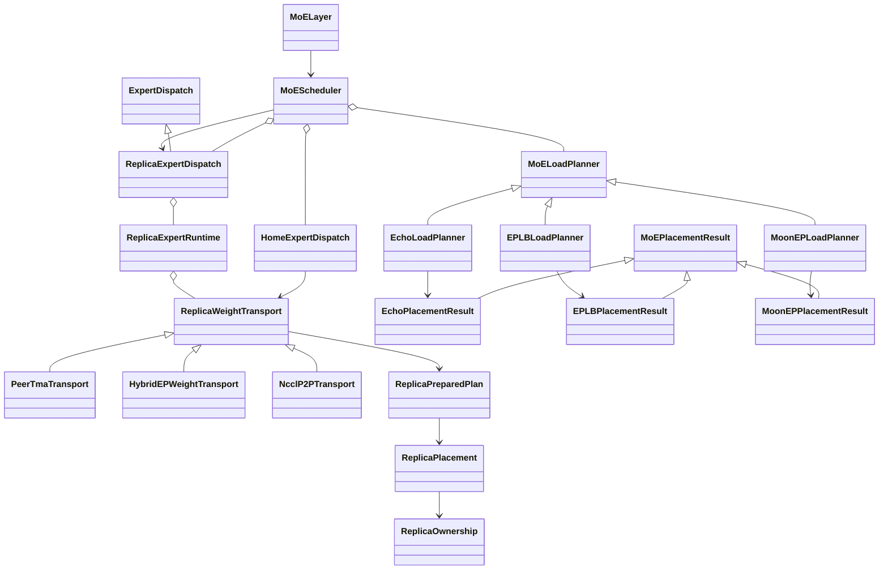

# MoE load balancing (experimental)

MoE Scheduler addresses load imbalance in dropless MoE models by replicating
hot logical experts into idle physical expert slots and rerouting tokens to the
replicas. It is designed as a preprocessing stage between router output and the
existing Megatron token dispatcher.

The scheduler does not introduce planner-specific branches into the remaining
MoE execution path. After scheduling, `MoELayer` continues through its normal
token preprocessing, dispatch, expert computation, combine, and backward flow.

## Design Goals

- Decouple load planning from expert-weight movement so planners and expert
  dispatch backends can be combined through one contract.
- Keep backend-native state, such as Echo offloading maps, EPLB replica tables,
  and MoonEP replica plans, private to concrete implementations.
- Split placement from token rerouting so asynchronous expert-weight dispatch
  can overlap reroute work without exposing planner-specific state.
- Make planners return final token reroute tensors so token dispatchers do not
  need to understand the selected planning algorithm.
- Keep the public planner/dispatcher boundary small enough to lower efficiently
  into different expert communication backends.

## Architecture

| Component | Responsibility |
| --- | --- |
| `SchedulerContext` | Carries layer, logical/local expert, EP rank/group, router top-k, training mode, and configuration context. |
| `MoEPlacementResult` | Opaque, explicit state passed between a planner's placement and reroute phases. |
| `MoELoadPlanner` | Updates the physical layout, and reroutes tokens against that placement. |
| `ExpertDispatch` | Validates/materializes a physical placement and owns forward/backward lifecycle hooks. |
| `MoEScheduler` | Orchestrates placement, asynchronous expert materialization, and token rerouting. |
| `MoELayer` | Invokes the scheduler between routing and token preprocessing. |

The planner contract is split into two phases:

```python
home_expert_placement, replica_expert_placement, placement_result = planner.update_placement(
    probs, routing_map, context
)
routing_map, probs = planner.reroute(
    probs, routing_map, placement_result, context
)
```

Logical mappings are private to the planner. `home_expert_placement` is an
optional `HomeExpertPlacement(source_slots, version)` with a `[EP, H]` source
permutation. `replica_expert_placement` is an optional `[EP, S]` integer table,
with `-1` for inactive replicas. Both tables are destination-major and encode
**physical** sources as `rank * H + local_home_slot`. `placement_result` is
opaque reroute state. `reroute()` returns dense physical route/probability tensors.

`MoEScheduler` calls `HomeExpertDispatch` and `ReplicaExpertDispatch` directly.
Home dispatch stages metadata until `scheduler.step()`; replica dispatch starts
weight prefetch immediately and retains the source table through backward. Both
use the same transport implementation. Replica runtime owns TE/GTP bindings and
gradient handoff. Transport never interprets logical identity or optimizer state.

## Class Diagram



## Implemented Components

| Type | Config value | Implementation | Status |
| --- | --- | --- | --- |
| Planner | `echo` | `EchoLoadPlanner` | CUDA/Triton assignment and token reroute aligned with Echo PR #2368. |
| Planner | `eplb` | `EPLBLoadPlanner` | Greedy replication, optional periodic home LPT permutations, and global round-robin rerouting. |
| Planner | `moon_ep` | `MoonEPLoadPlanner` | PR #7450 padding-aware placement with symmetric-memory histogram exchange and separate rerouting. |
| Expert dispatch | `replica_peer_tma` | `ReplicaExpertDispatch` | One replica lifecycle implementation; the type currently selects `PeerTmaTransport`. |
| Expert dispatch | `replica_hybridep` | Same dispatcher, `HybridEPWeightTransport` | Reserved; rejected during configuration validation. |
| Expert dispatch | `replica_nccl` | Same dispatcher, `NcclP2PTransport` | Packed NCCL P2P; BF16/MXFP8 weights, BF16/FP32 gradients, host planning. |

UltraEP is a planned integration. It should implement the same common planner
output or expert-dispatch input semantics instead of exposing UltraEP-native
metadata in the public interface.

## Execution Flow

1. The dispatcher wraps the MoE layer input when backward work must complete
   after router, shared-expert, and latent-projection backward.
2. The router produces logical-expert `probs` and `routing_map`.
3. `MoELayer` calls `MoEScheduler.schedule()`.
4. Every enabled scheduler invocation plans, dispatches, and reroutes.
5. `update_placement()` returns optional home/replica source tables and an
   opaque `MoEPlacementResult`.
6. The scheduler stages a home proposal and asynchronously starts current-home
   replica copies. Pending home ownership is never used by this forward.
7. `reroute()` converts the original logical routes to physical routes while
   expert-weight communication is in flight.
8. The existing token dispatcher consumes the physical routing tensors and
   runs the normal dispatch, expert compute, and combine stages.
9. During backward, the replica runtime starts FC2 reduction directly behind
   its wgrad GEMM, starts pending FC1/FC2 reductions after dispatch backward,
   and waits at the layer input before publishing source gradients.

## Configuration

A minimal Echo configuration is:

```yaml
moe_enable_scheduler: true
moe_scheduler_planner_type: echo
moe_scheduler_expert_dispatcher_type: replica_peer_tma
moe_scheduler_num_idle_experts: 4
```

**Configuration migration:** the former `replica_hybridep` value selected
Peer-TMA, despite its name. It has been renamed to `replica_peer_tma`, which
is also the default. Update existing YAML/CLI configurations to that value.
`replica_hybridep` is now reserved for the actual HybridEP weight backend and
fails with a migration message; it never silently selects a different data
path. Both implemented transports use `ReplicaExpertDispatch` from
`replica_expert_dispatch.py`; the common dispatcher has no transport-specific
name or compatibility alias.

Set `moe_scheduler_expert_dispatcher_type: replica_nccl` to use packed NCCL
P2P with BF16 or native MXFP8 weights and BF16 or FP32 gradient storage. It requires an
initialized NCCL EP group and the current CUDA device to match the runtime
device. Construction is collective across that group. CUDA graph capture
including MoE is rejected; attention-only graphs remain supported. MXFP8
requires `fp8: e4m3`, `fp8_recipe: mxfp8`, and `fp8_param: true`.

For MoonEP, set `moe_scheduler_planner_type: moon_ep`. The current MoonEP
implementation allocates one replica slot for every home expert, so
`moe_scheduler_num_idle_experts` must equal `num_moe_experts`.

For EPLB, set `moe_scheduler_planner_type: eplb`. `EPLBLoadPlanner` gathers the
current logical-expert loads across the EP group, greedily assigns redundant
instances according to `load / replica_count`, and LPT-packs those instances
into the fixed replica slots. It follows the core replication and packing
policy of [DeepSeek EPLB](https://github.com/deepseek-ai/EPLB). Homes remain fixed
by default; `moe_scheduler_home_update_interval` enables periodic migration.

All planners use the transport-backed `ReplicaExpertRuntime`. It supports an
`E + R` runtime layout, where `R` is positive and divisible by the EP size.
Every rank owns `E / EP` native experts followed by `R / EP` replica slots. It
requires the HybridEP flex token dispatcher, BF16 execution, TE grouped GEMM
with the operation fuser, and fused gradient accumulation. With Peer-TMA or NCCL, weights may be BF16
or native-parameter MXFP8 E4M3; FP4 and other FP8 recipes are rejected. The
current `replica_peer_tma` type selects `PeerTmaTransport`, which requires a
single NVLink domain and a PyTorch/NCCL build with working native NCCL
symmetric-memory support.

Current constraints:

- Dropless MoE only; expert capacity and capacity padding must be disabled.
- `num_moe_experts` and `moe_scheduler_num_idle_experts` must be divisible by
  the expert-model-parallel size.
- `add_bias_linear` must be disabled.
- Both replica expert dispatchers require discrete native expert
  weights and the Transformer Engine operation fuser; single grouped expert
  weights are unsupported.
- The HybridEP flex token dispatcher requires a build with HybridEP support.
- The MoonEP planner requires CUDA, initialized EP distributed groups, and one
  replica slot per local home expert. Its PR #7450 placement kernel uses an
  NCCL symmetric-memory histogram window; rerouting is a separate kernel.
- EPLB uses the current invocation's EP-global token counts for replica placement
  with fixed homes. With home migration enabled, it accumulates loads over the
  update interval and commits proposed homes after a successful optimizer step.
  Hierarchical multi-node expert-group placement is not implemented.
- MoE CUDA graph capture requires `replica_peer_tma`, an explicit
  `moe_expert_rank_capacity_factor`, and a storage policy without exact weight
  caching (shared storage, or MXFP8 layerwise storage with `reuse`). Separate
  `moe_router` and `moe_preprocess` scopes are rejected. Attention-only capture
  is allowed for both transports and all storage policies. MoE activation recompute is also rejected for this lifecycle.
  The physical-expert token-dispatcher config does not own graph capture;
  it clears its layer-level graph policy while the enclosing logical MoE
  layer retains the requested capture scopes. Dispatcher kernels execute
  within that enclosing graph. MoonEP converts replica placement to the common
  physical layout with fixed-shape selection, so changing inactive replica slots
  on graph replay never requires dynamic-size boolean indexing.
- When GTP exposes #6892's non-consuming peek protocol, the weight push peeks
  at gathered weights and the expert GEMMs perform the real consume. Older GTP
  implementations retain the pre-existing consume-at-push compatibility path.

Rank 0 logs the configured planner, dispatcher, and idle expert count at startup. The first scheduled forward also logs routing
shapes, physical expert and transfer counts, and whether planning and expert
materialization ran.

## Code Map

| Path | Purpose |
| --- | --- |
| `megatron/core/transformer/moe/moe_scheduler.py` | Shared two-phase planner interfaces and scheduler orchestration. |
| `megatron/core/transformer/moe/echo_moe_scheduler.py` | Echo planner and Triton reroute path. |
| `megatron/core/transformer/moe/eplb_moe_scheduler.py` | EPLB greedy replication, fixed-home LPT placement, and round-robin reroute. |
| `megatron/core/transformer/moe/moonep_moe_scheduler.py` | MoonEP/PR #7450 planner adapter and common-IR conversion. |
| `megatron/core/transformer/moe/moonep_replica_triton.py` | #7450 histogram/placement and route-mapping Triton kernels. |
| `megatron/core/transformer/moe/replica_expert_dispatch.py` | Common placement adapter and replica forward/backward lifecycle. |
| `megatron/core/transformer/moe/replica_expert_runtime.py` | TE/GTP runtime weights, gradient handoff, and transport coordination. |
| `megatron/core/transformer/moe/replica_weight_transport.py` | Backend-neutral replica weight/gradient transport contract and factory. |
| `megatron/core/transformer/moe/replica_peer_tma_transport.py` | Symmetric-memory peer-TMA transport and shared workspace. |
| `megatron/core/transformer/moe/replica_hybridep_transport.py` | Reserved HybridEP weight backend; not implemented. |
| `megatron/core/transformer/moe/replica_nccl_transport.py` | Packed NCCL P2P, host schedules, and FP32 gradient accumulation. |
| `megatron/core/transformer/moe/replica_weight_triton.py` | Peer-TMA weight transport and projection-selective gradient-reduction kernels, generalized to variable replica slots. |
| `megatron/core/transformer/moe/moe_layer.py` | Integration between logical routing and the existing token dispatcher. |
| `megatron/core/transformer/transformer_config.py` | Scheduler configuration and compatibility validation. |
| `tests/unit_tests/transformer/moe/test_moe_scheduler.py` | Common contract and orchestration tests. |
| `tests/unit_tests/transformer/moe/test_echo_moe_scheduler.py` | Echo planner, unified replica dispatch, and `MoELayer` integration tests. |
| `tests/unit_tests/transformer/moe/test_eplb_moe_scheduler.py` | EPLB placement, global reroute, gradient, and factory tests. |
| `tests/unit_tests/transformer/moe/test_moonep_moe_scheduler.py` | MoonEP planner and cross-component compatibility tests. |
| `tests/unit_tests/transformer/moe/test_replica_weight_transport.py` | Plan ownership, layout, completion lifetime, and placeholder contracts. |
| `tests/unit_tests/transformer/moe/test_replica_nccl_transport.py` | NCCL weight/gradient parity, strided EP subgroups, empty ranks, and stream completion. |

## Replica Transport Contract

The planner lowers logical choices to physical source slots. Replica dispatch
retains an immutable source table through forward/backward and assigns a
dispatcher-local generation. `ReplicaExpertRuntime` wraps that slot table in
`ReplicaPlacement`, with a separate `ReplicaOwnership` descriptor. The current
owner mapping is uniform and fixed; optional explicit owner tables reserve an
extension point and are rejected by Peer-TMA and NCCL P2P. Periodic home exchange
moves contents among these fixed physical sources, so replica transport needs
no logical ownership table. Each rank still has H home slots followed by S replicas.

`transport.prepare_plan(placement)` produces a `ReplicaPreparedPlan` belonging
to that exact transport instance. Peer-TMA keeps device metadata; NCCL
compiles host peer schedules, while a future HybridEP implementation can
compile chunk routing. The common layer never expands chunk routing or reads the
placement back to the CPU. Runtime caches are weak and keyed by plan identity,
not the address of a recycled slot. A future host-scheduled backend must
document synchronization and reject unsupported graph capture. CUDA graph
replay can update device metadata without executing Python or incrementing a
Python generation: cached host schedules must never assume otherwise.

Each `ReplicaWeightSource` exposes canonical local-expert data and optional
scales, with explicit plain/rowwise/columnwise layout. Tensor shape and dtype
describe the components; wire encoding and packing belong to the transport.
Optional pointer tables remain a Peer-TMA fast path. TE wrappers, GTP peeks,
direction selection and optimizer handoff remain in the runtime.

Each start returns a distinct `ReplicaTransferHandle`, separate from reusable
scheduling metadata. A weight completion covers unpack and final layout;
a gradient completion covers `native += sum(replicas)`, including local
replicas, with FP32 accumulation and one final cast. Native gradients are not
cleared. Reduction order can differ between backends; bitwise equivalence is
not promised. Every wait orders its calling stream, including repeated waits
for resident weights. Handles retain operation inputs, but backends must also
protect allocator lifetimes and callers must not overwrite sources or buffers
while the GPU uses them.

Storage views remain stable until teardown. The existing Peer-TMA shared
workspace and its serialized layer lifecycle are preserved; the interface
does not promise independent concurrent storage per layer. New transports
should first use per-layer buffers before introducing shared pools. Only
initialized backends register finalizers, so cleanup does not import unused
Triton/symmetric-memory dependencies. Capabilities advertise implemented
weight formats, gradient dtypes, device planning, graph support and explicit
ownership; placeholders advertise none. Topology compatibility remains a
backend initialization requirement, not an automatic fallback policy.

NCCL P2P can move weights across nodes without symmetric-memory allocation.
Full scheduler execution also requires compatible planner and token-dispatch paths; current scheduler
configuration still requires HybridEP tokens and the MoonEP planner still
uses symmetric-memory histogram exchange.

## NCCL P2P Transport Design

The NCCL backend supports plain BF16 or MXFP8 weights and either BF16 or FP32
replica/native gradient storage. It does not import Peer-TMA, Triton, or
symmetric-memory helpers. TE parameter wrappers, GTP materialization, backward
weight selection and optimizer handoff remain in `ReplicaExpertRuntime`.

`prepare_plan()` performs one synchronous device-to-host copy of the global
`[EP, replica_slots]` placement per immutable microbatch plan. It validates
physical source IDs, skips `-1`, and derives owners using uniform canonical
ownership. The prepared schedule stores only peer ranks, native indices and
replica slots. It never retains source addresses, so backward may use newly
materialized weights. All ranks must provide the same placement; no extra
placement or count exchange occurs in the steady-state path.

For weights, each owner packs both projections into one contiguous BF16
message per destination, ordered by projection and destination slot. Batched
`isend`/`irecv` operations use global ranks translated from EP ranks and a
consistent directed-edge ordering. Local replicas use device copies. The
receiver unpacks into stable replica storage according to the selected allocation policy. Duplicate experts
in distinct slots are currently sent separately; unused slots are untouched.

MXFP8 sends raw quantized data and E8M0 scale bytes together in one uint8
message per peer. The wire order is FC1 data, FC1 scales, FC2 data, FC2 scales,
with each component in destination-slot order. Scale extents come from the
runtime's directional metadata, including TE padding; no fixed scale-to-data
size ratio is assumed. Rowwise and columnwise data/scales follow the selected `reuse` or `separate`
storage policy, returned in the TE wrapper contract's four-component order. A forward
push updates only rowwise storage, and a backward push only columnwise storage.
No quantization, dequantization, transpose, or scale swizzle occurs in transport;
the runtime retains TE's dtype, quantizer, and scale-layout metadata. The `separate` policy uses
more replica weight memory than direction-aliasing `reuse` storage.

Gradients follow the same routes in reverse, only for the requested
projections. The owner adds local and received replica gradients to the
existing native gradient in FP32, then casts once into the supplied native
gradient destinations. Unreferenced native experts remain untouched. FC2 and
FC1 can start separately, preserving the runtime's FC2-first backward order.

Both transports support shared or layerwise replica storage and share communication
ordering among compatible layers. Regular DDP native gradients bind to model
`main_grad`. For staging callers, native-gradient storage is private by default. `ReplicaExpertRuntime` opts into
`share_native_grad_storage`: compatible serialized layers reuse one staging
allocation per EP group, device, native-expert count, matrix shapes, and dtype.
The runtime finishes reduction and consumes/forwards the result at its
layer-input backward boundary before another layer writes staging, matching
Peer-TMA's existing shared-staging lifecycle. A weak cache releases the pool
after its last transport is destroyed. This avoids retaining a full extra
expert-gradient copy for every layer. Independent callers must leave sharing
disabled unless they provide the same consumer ordering.

A start waits for
its producer stream, packs messages, submits batched P2P, waits on NCCL Work
objects on the communication stream, and enqueues unpack or accumulation.
The returned event covers all of that work. Every wait inserts an event wait
on its calling stream, including repeated waits on different streams. Normal
NCCL waits order GPU work; enabling NCCL blocking-wait settings can also block
the host. Temporary buffers and input references are retained internally
until the event completes, even if the caller drops the handle. Tensor stream
tracking protects allocator reuse. Callers must still order consumers before
explicitly overwriting sources or reusable replica storage.

Construction must run in matching order on every EP member. It performs a
small all-reduce on the borrowed NCCL group before any sparse batched P2P, so
ranks without traffic need not participate in subsequent P2P batches. All
layers and other users of the same group must maintain matching communication
submission order. `destroy()` drains this layer's communication stream and
releases its storage references, without destroying the borrowed group.

Capabilities are conservative: host planning and dynamic message sizes mean
`device_plan=False`, `cuda_graph=False`, and `explicit_ownership=False`.
Both plan preparation and operation starts reject CUDA capture, even for
plans prepared before capture. `num_sms` is unused because the backend does
not expose a portable per-operation NCCL SM limit. Future optimizations can
add peer-local deduplication, reusable staging pools, and fused pack/reduce
kernels after measuring the baseline. Static CUDA-graph schedules require a
separate implementation and validation.

## Extending MoE Scheduler

To add a planner:

1. Subclass `MoELoadPlanner` and implement `update_placement()` and `reroute()`
   for every enabled scheduler invocation.
2. Return optional home/replica physical source tables plus a `MoEPlacementResult`
   subclass from `update_placement()`. Keep logical layouts and backend-specific
   allocation state private to the planner.
3. Return dense physical `routing_map` and `probs` from `reroute()`.
4. Register the planner in `MoEScheduler.from_config()` and
   `TransformerConfig` validation.
5. Add contract tests and at least one planner/dispatcher compatibility test.

To add a replica communication mode while retaining the single expert dispatcher:

1. Implement `ReplicaWeightTransport`, including transport-owned storage views.
2. Keep TE, GTP, MXFP8, and optimizer semantics in `ReplicaExpertRuntime`.
3. Register the transport against an expert-dispatch type in
   `create_replica_weight_transport()`; all types instantiate
   `ReplicaExpertDispatch`.
4. Compile only backend-private schedules in `prepare_plan()` and preserve
   layout, ownership, storage lifetime and asynchronous completion semantics.
5. Add factory, forward/backward lifecycle, and multi-rank correctness tests.

Run the focused unit tests from the Megatron-LM repository root:

```bash
python -m torch.distributed.run --nproc-per-node 8 -m pytest \
  tests/unit_tests/transformer/moe/test_replica_weight_transport.py \
  tests/unit_tests/transformer/moe/test_replica_nccl_transport.py \
  tests/unit_tests/transformer/moe/test_moe_scheduler.py \
  tests/unit_tests/transformer/moe/test_echo_moe_scheduler.py \
  tests/unit_tests/transformer/moe/test_eplb_moe_scheduler.py \
  tests/unit_tests/transformer/moe/test_moonep_moe_scheduler.py
```


## Periodic Home Expert Exchange (NCCL)

Enable alongside the existing scheduler configuration:

```yaml
moe_enable_scheduler: true
moe_scheduler_planner_type: eplb
moe_scheduler_expert_dispatcher_type: replica_nccl
moe_scheduler_num_idle_experts: 4
moe_scheduler_home_update_interval: 50
```

The first 50 successful updates collect logical load history. The first forward
after that interval proposes a permutation; migration runs after that iteration's
optimizer update. Exactly H unique canonical homes remain on every rank. LPT uses
per-instance load after greedy replica selection. This is a constrained EPLB
policy: unrestricted placements cannot always preserve a fixed home capacity.

EPLB keeps active and pending home/replica mappings. In periodic mode both logical
placements are committed together at the successful-step boundary; unchanged
replica placements still issue fresh weight copies on every microbatch. Each
microbatch reroutes against the active mapping and current home slots.
`HomeExpertDispatch.dispatch` snapshots only the proposal, never stale weights.
At the drained optimizer boundary, `MoEScheduler.step()` calls home dispatch
first and `planner.step(completed_version)` second. Failed optimizer updates
retain both the old mapping and pending proposal.

`prepare_home_expert_step(model, optimizer)` and `finish_home_expert_step(...)`
wire this boundary into the Megatron training loop. Custom training loops must
use the same boundary, or bind a state adapter and arrange communication fences
before calling each scheduler's `.step()`. All replica microbatches must finish.
Next-step DDP/FSDP gathers are deferred during migration, including the chained
optimizer MXFP8 gather path, and restarted only after weights are refreshed.

NCCL exchanges typed state components into separate staging buffers. Cyclic
permutations and same-rank swaps cannot overwrite a source before it is read.
The optimizer adapter moves authoritative parameters and tensor-valued optimizer
states in place. Parameter objects, master/moment addresses and bucket views are
preserved. Uneven or empty DistributedOptimizer/FSDP shards are reconstructed
over their optimizer DP group, exchanged over EP, and sliced into each destination's
own shard range. Existing optimizer copy/cast functions regenerate BF16/MXFP8
model weights and scales. This first implementation uses a full-layer state
snapshot and a device fence; migration is intentionally outside CUDA capture.

Supported adapter storage is resident, uncompressed elementwise optimizer state,
including ordinary Adam masters and moments, DDP mixed-precision masters,
DistributedOptimizer shards and Megatron-FSDP main-weight buffers. Precision-aware
compressed states, CPU/chunked optimizer offload, layer-wise optimizers and non-elementwise optimizer
states require dedicated adapters and are rejected. Peer-TMA exposes explicit
home-exchange placeholders; its existing replica APIs remain supported.

Checkpoints retain physical parameter slots and the EPLB `_extra_state` mapping,
step counter and load history. Resume requires the same EP/home-slot topology.
Parallel-topology changes are unsupported. To continue with the scheduler
disabled, first export an ordinary logical expert checkpoint as described below.

`test_home_expert_exchange.py` checks delayed reads of post-update weights,
local/cross-rank cycles, exact Adam continuation over repeated updates, mixed
tensor formats, repeated consumer-stream waits, uneven/empty optimizer shards,
active/pending routing, checkpoint metadata and explicit unsupported operations.

## Initialization and routing contract

Every enabled scheduler invocation executes `update_placement`, dispatch, and
`reroute`; there is no planning-skip hook. ECHO uses `one_shot_greedy` only.
There is no configurable ECHO assignment algorithm.
Unimplemented HybridEP weight transport, MoonEP/peer-TMA EP sizes above 64,
and MoonEP expert counts above 8192 are rejected before allocation. MoonEP
requires equal physical token counts on all EP ranks; post-planner variable
token equalization cannot satisfy this requirement and is rejected.

Learned and mock routing retain exactly top-k assignments on padding rows
with zero probabilities. Padding contributes physical work to the planner but
no expert output or gate gradient. Scheduler-disabled dropless HybridEP keeps
its existing sparse padding behavior.

CUDA, explicit NCCL EP groups, HybridEP, Triton, TE grouped ops, and the fused
GroupedMLP environment setting are checked before constructing expert weights.
MoonEP's symmetric histogram window is initialized at that boundary. Home optimizer
configuration is checked in `arguments.validate_args` after defaults and argument
normalization. Actual state representations and physical parameter bindings are
checked during optimizer initialization, not at the first migration. Supported home
optimizers are Adam and SGD with resident, uncompressed state.

## Checkpoint transitions

Loading a scheduler-disabled checkpoint with home migration enabled starts a
new training run: weights are loaded in identity home order, optimizer and
training/RNG progress are not restored, and counters start at zero. The source
must contain topology metadata and use the same EP/TP/PP/CP/world topology.
No exchange occurs during loading. The first forward initializes planner
history and normal `update_placement` proposals trigger later migrations at
successful optimizer boundaries. No planner state is required only for this
explicitly detected logical-weight initialization. Missing planner state in a
home checkpoint remains fatal, even with non-strict loading.

Resuming a home checkpoint requires unchanged topology and scheduler settings.
Changing parallel topology is unsupported. To disable the scheduler, first
export a canonical logical checkpoint using the original topology and scheduler
configuration:

```sh
# Append to the original model/training command; conversion saves and exits.
--load /path/to/home-checkpoint \
--ckpt-convert-format torch_dist \
--ckpt-convert-save /path/to/logical-export \
--moe-scheduler-export-logical-checkpoint
```

For Megatron-FSDP, use `--ckpt-convert-format fsdp_dtensor` instead; the output
is an ordinary logical FSDP checkpoint under the `fsdp_dtensor` subdirectory.
Export preserves the optimizer representation and saves synchronously before exit.

Export requires optimizer masters/state (`--finetune`, `--no-load-optim`, and
`--no-save-optim` are incompatible). It restores committed physical homes to
logical expert order together with master weights and optimizer tensors, then
regenerates compute weights and saves with scheduler metadata disabled. A
pending, uncommitted planner proposal is not applied. The output is an ordinary
checkpoint under `/path/to/logical-export/torch_dist`, loadable with the scheduler
disabled, including optimizer continuation. Export is terminal: the in-memory
token dispatcher is not reconfigured for continued execution in that process.

## Replica storage and caching

Peer TMA and NCCL P2P support two independent options:

| Option | Values | Default |
| --- | --- | --- |
| `--moe-scheduler-replica-storage` | `shared`, `layerwise` | `shared` |
| `--moe-scheduler-replica-mxfp8-storage` | `reuse`, `separate` | `reuse` |

`shared` reuses replica weights, scales, and gradients among compatible layers
on the same EP group/device. `layerwise` allocates private replica storage.
Regular DDP native gradients alias persistent `main_grad` buffers. FSDP, GTP,
and overwrite callers retain the separate native-gradient staging contract.
`reuse` aliases rowwise and columnwise MXFP8 storage; `separate` retains both
orientations. The second option has no effect on BF16 allocation.

For example, enable directional caching with:

```sh
--moe-scheduler-replica-storage layerwise \
--moe-scheduler-replica-mxfp8-storage separate
```

The runtime lazily fills each directional cache. A hit skips replica transport,
not native expert/GTP materialization or completion waits. Cache validity uses
exact placement and local source-byte/scale snapshots, not plan object identity
or Tensor version counters. This detects optimizer updates, checkpoint writes,
requantization, and home migration even when writes bypass version counters.
An EP-wide miss reduction ensures all senders and receivers agree. Snapshot
storage is an additional per-layer cost in this opt-in mode; comparisons and
the control collective also have a runtime cost. BF16 layerwise storage supports
the same cache with its single plain layout.

Shared storage and MXFP8 reuse mode do not enable this cache optimization.
The first backward must populate columnwise data; a cached rowwise tensor is
not a substitute for independently quantized columnwise bytes. An older
microbatch's placement can require a refresh after another placement overwrote
its directional cache. No gradients are cached: each microbatch still computes
and reduces its own replica gradients.

## Consumer lifetime

A runtime acquires a group/device consumer fence before prefetch and releases
it after token combine in forward, or after gradient publication in backward.
The next producer waits on the last consumer event. Communication completion
alone does not authorize overwrite. Unreleased/reentrant consumers raise an
error instead of overwriting shared storage. Source producers and GTP's
materialize/consume protocol remain intact on cache hits.

NCCL workspaces share the communication stream and completed-transfer cleanup,
so layer-local lists do not retain old temporary messages until that layer is
visited again. Peer-TMA symmetric windows have explicit transport reference
counts; destroying one shared user does not invalidate the others.
Completed NCCL handles retain only their completion event and transport;
the workspace releases packed messages after their GPU work completes, even
when a layer keeps an old handle for repeated waits.

## CUDA graphs and diagnostics

An unset `--moe-expert-rank-capacity-factor` preserves dropless dispatch for both
transports. ECHO/EPLB use HybridEP's dynamic output sizing. MoonEP supplies a
per-invocation bound on padded rows; HybridEP consumes it without adding padding
a second time and checks overflow on-device, avoiding dynamic output sizing in
eager execution. The scheduler does not imply a static
capacity of 1.0: a planner can leave a rank above the mean token count, and
per-expert padding can increase the required capacity further. Explicit static
capacity remains supported and requires the training overflow retry path when
the budget is exceeded. Capturing MoE requires an explicit static capacity;
the eager MoonEP bound does not relax that configuration restriction.

The exact cache requires host decisions and cannot run inside a captured MoE
region. Attention-only CUDA graphs remain supported. NCCL retains its existing
restriction against captured host-scheduled MoE communication.
`runtime.weight_cache.hits` and `.misses` expose collective cache decisions for
tests and profiling. Source snapshots and cache entries are ephemeral and are
not checkpoint state.

## Tests

`tests/unit_tests/transformer/moe/test_replica_storage.py` exercises both backends
and all four policies with BF16/MXFP8, exact bytes/scales, additive gradients,
consumer streams, rank-asymmetric cache invalidation, old placement restoration,
and real TE MXFP8 forward/dgrad GEMMs with repeated runtime prefetch requests.
The existing NCCL transport and runtime boundary suites remain regression tests.

`test_scheduler_bf16_layer_parity.py` compares a real scheduler-disabled
MoELayer against each transport, using identical initial weights, inputs and
upstream gradients. On four GB200 GPUs it checks forward, input gradients,
router/expert gradients, and one distributed Adam update with one or four
microbatches. It checks FP32 master-weight deltas as well as BF16 weights, so
the initial parameter magnitude cannot hide an incorrect optimizer update.
This is a paired production-path diagnostic, not an independent mathematical
reference. A separate insufficient-static-capacity control must report both
dispatch overflow and numerical disagreement. The six cases pass per rank;
dynamic-capacity forward and input gradients match exactly in this recipe.


## Module boundaries

`MoEScheduler` owns the training-facing prepare, step, logical-load, and export
operations. Planners provide logical export placements through `MoELoadPlanner`;
training code never interprets committed or pending planner layouts. Home dispatch
has its own typed contract because it stages `HomeExpertPlacement`, unlike replica
dispatch's Tensor placement. It owns installation health and terminal export.
Replica dispatch binds the borrowed transport and optimizer adapter without
exposing its runtime to scheduler orchestration.

Optimizer leaves expose `get_parameter_state_binding`,
`defer_param_sync_for_state_update`, and `refresh_model_weights`. Bucket maps,
master-to-compute casts, and FSDP shard offsets remain owned by optimizer/FSDP.
The home adapter receives source parameters and transport configuration, not the
whole replica runtime. Expert modules own runtime detachment and fused-op cleanup.
Scheduler diagnostics use module loggers at INFO level, following application
logging configuration; they do not print directly to stdout.


`test_scheduler_release_contracts.py` covers learned padding/autograd,
distributed MoonEP routing, logical checkpoint load and export with Adam
continuation, failed-install protection, module logging, optimizer hold release,
parameter bindings, and configuration capacity checks. These focused tests do
not establish full FSDP/MXFP8 training parity.


## PR #7450 alignment (no scheduler-interface or GTP migration)

The MoonEP kernels track PR #7450 at `242c8dbc63c17ec804f1e31974d3dec86e5ed56c`.
The scheduler still calls `update_placement`, replica dispatch, then `reroute`.
Placement and reroute remain separate launches and retain the dense routing IR.
Consequently this branch does not claim the PR's fused planner/side-stream
scheduling overhead or end-to-end training performance.

Placement rounds each global logical expert count once into GEMM-aligned blocks
(256 for the supported fused grouped MLP), balances these blocks, and assigns
remainder blocks to lower ranks. Routes retain their source-rank/token order;
conceptual padding occurs only at the logical expert's end. Real route totals
can differ between destinations. This applies to BF16 as well as MXFP8.
The 32-program planner handles up to two EP ranks per program. Reroute uses
512-route sort/scan tiles and binary search while emitting the existing dense
probabilities with autograd. Compiled launchers are cached by shape, dtype,
alignment and input-pointer alignment. Token shape can change between eager
invocations; each shape gets its own specialization and capacity.

For R routes per source rank, P ranks, E logical experts and alignment A,
`blocks = (P*R + min(E, P*R)*(A-1)) // A` and the padded capacity is
`A * ceil(blocks/P)`. The optional padded-capacity metadata is independent of
an unpadded route bound. Explicit user capacity and overflow-retry policy take
precedence over both bounds. The existing explicit-capacity requirement for
captured MoE remains in place.

Peer-TMA pushes use the PR's TMA reads and coalesced uint64 peer stores for both
weight bytes and quantization scales. Existing transport completion and consumer
fences remain in force. Regular DDP natives accumulate directly into persistent
`main_grad`; virtual slots are zeroed before each accumulating backward. The
handoff triggers original parameter hooks without re-adding native gradients.
Runtime leaves do not request dummy gradients from TE. Overwrite/FSDP/GTP callers
retain staging; GTP gather/reduction behavior is unchanged. Native staging is
still allocated by the transport for fallback compatibility.

An unbound runtime can be destroyed without changing the expert layer's native
fused ops. Detaching a runtime owned by another layer remains an error.

The existing TE weighted squared-ReLU expert path is allowed by scheduler
configuration, with `ScaledSReLU` checked during environment initialization.
Quantile routing and upstream grouped-tensor/GTP API migration are outside this
change. All comparisons use a common supported recipe, not the PR's GTP recipe.

`test_moonep_pr7450_alignment.py` checks the pinned PR's independent CPU oracle,
local EP33/64 layouts, real EP communication and graph replay.
`test_moonep_pr7450_training.py` checks DDP accumulation and BF16/MXFP8 Adam
updates with mock/learned routing and weighted squared-ReLU. Local EP64 simulation is
not a 64-GPU collective test. The optional `test_moonep_pr7450_benchmark.py`
requires the unmodified, hash-pinned PR kernel source and records eager and CUDA
graph timings, including equivalent dense-output measurements; it does not enforce noisy CI speed gates.

The FC2 wgrad callback belongs to `ReplicaExpertRuntime`. Expert construction
obtains it through `make_fc2_wgrad_store()`. It executes TE's wgrad callback
before starting FC2 replica reduction, preserving overlap with the remaining
backward work. Removing it would defer reduction until the later fallback
boundary. The callback does not defer the GEMM to another training phase.


## Cached mock routing for scheduler benchmarks

Set `--moe-router-mock-maxvio 1.5` to replace learned/Hash-MoE expert choices
with deterministic logical expert assignments. The target is the maximum EP
rank assignment count divided by the mean, measured against the **initial**
contiguous home layout, before scheduler rerouting and alignment padding.
Each token still selects `topk` distinct experts. Initial rank 0's expert group
is hot on every source rank; other groups share the remaining routes evenly.
For E experts, R EP ranks and K routes, the supported range is
`[1, R * min(K, E/R) / K]`. Integer counts can introduce rounding error.

`MockRouteCache` builds each token-shape/device template once without advancing
the training RNG. Gate projection and fresh differentiable probability scores
still run on every forward. The router emits this branch's existing dense bool
routing map and probability matrix. MoEScheduler's planner performs its normal
placement and reroute operations; dispatchers and transports need no mock mode.
EPLB home migration changes physical ownership without changing the cached
logical expert choices, so actual GPU load can differ from the initial target.

Padding uses device-side valid-token ordinals. With MoEScheduler enabled,
padded rows retain K dummy routes but have zero scores and gate gradients;
dummy assignments count toward the planner's physical work. Without the
scheduler, padded rows are removed from the route map. Warm every shape/device
before CUDA Graph capture; a cold cache during capture raises explicitly.
Caches live with the router, are not saved in checkpoints, and are rebuilt
deterministically. Changing the target requires a new router/cache.

This is a load-benchmark option. It disables routing balancing auxiliary losses
but retains Z-loss. It rejects force-balance, forced bias, expert-bias updates,
routing replay, group-limited selection, token dropping, expert TP > 1 and
Sinkhorn. Leave it unset for ordinary learned routing. Toolkit recipes must also
use `--no-force-balance` to avoid the launcher's default forced balancing.

## Empty inputs in fused experts

A rank can receive no tokens under an imbalanced MoE route, including when the
scheduler is disabled. TE activation kernels must not receive a zero-row TMA
descriptor. The fused expert path pads an empty input to one aligned group of
zero inputs and zero probabilities, executes normal parameter hooks and expert
operations, then returns the empty output slice. Input and probability gradients
retain their original empty shapes; expert gradients remain zero and participate
in the ordinary DDP/optimizer lifecycle.

This is separate from scheduler placement or dispatch capacity. Nonempty inputs
retain the existing path. `test_fused_expert_empty_rank.py` exercises real TE,
HybridEP, DDP and distributed Adam with all routed work concentrated on one of
four ranks and checks zero expert gradients on the other ranks.

## Replica parameter-hook lifetime across optimizer steps

Forward prefetch invokes the native expert parameter hooks before reading
source weights, then marks that preparation for consumption by the fused MLP
forward hook. Backward prefetch also prepares native storage, but must not
mark a subsequent forward as prepared: no fused forward hook follows it.
The `for_backward` phase explicitly clears the forward-prepared flag.
Otherwise, after optimizer update, the next forward can skip DDP
`finish_param_sync` and read incomplete MXFP8 all-gather data. This applies
to all planners and replica transports; the scheduler-disabled path retains
its existing forward-hook behavior.

A forward/backward/update/forward regression checks that each forward
prefetch waits for the current weight generation and that the fused forward
does not duplicate hooks already run by its own forward prefetch.
